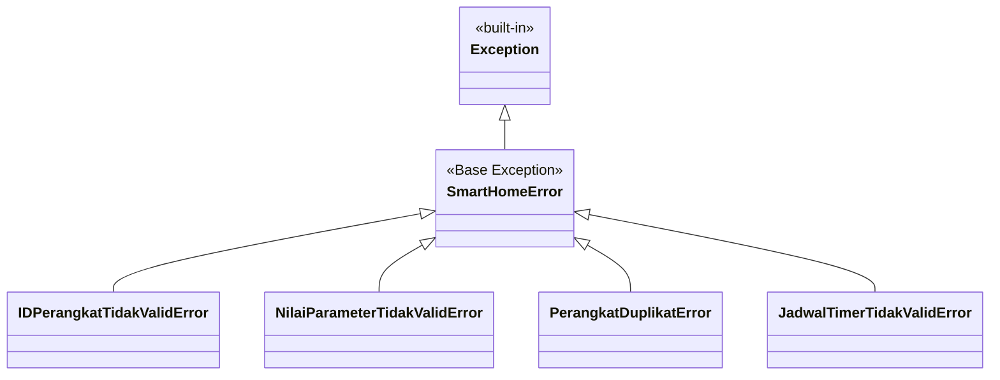

# Sistem Smart Home — Pengembangan Exception Handling (Python OOP)

Pengembangan proyek Ujian Tengah Semester (UTS) Pemrograman Berorientasi Objek dengan studi kasus **Sistem Smart Home** melalui penambahan mekanisme *exception handling* (penanganan pengecualian) menggunakan *custom exception*.

## Anggota Kelompok

| No | Nama Lengkap | NIM | Akun GitHub |
| :-: | :--- | :--- | :--- |
| 1 | `[Isi Nama Anggota 1]` | `[Isi NIM 1]` | `@username1` |
| 2 | `[Isi Nama Anggota 2]` | `[Isi NIM 2]` | `@username2` |
| 3 | `[Isi Nama Anggota 3]` | `[Isi NIM 3]` | `@username3` |

---

## 1. Identifikasi Aturan Bisnis yang Dapat Dilanggar

Sistem **Smart Home** terdiri atas kelas `SmartHub`, `Ruangan`, `PerangkatPintar` (Abstract Class), `TimerMixin`, `LampuPintar`, `ACPintar`, dan `CCTVPintar`. Berikut adalah lima aturan bisnis yang dapat dilanggar beserta lokasi validasinya pada kelas domain:

| No | Aturan Bisnis | Kondisi Pelanggaran | Kelas & Method Terkait |
| :-: | :--- | :--- | :--- |
| 1 | **Format ID Perangkat Wajib Valid** | ID perangkat bukan bertipe `str` atau panjang karakternya kurang dari 2 karakter. | `PerangkatPintar.__init__()` & `validasi_id()` |
| 2 | **Rentang Kecerahan Lampu (0–100%)** | Nilai kecerahan yang dimasukkan kurang dari `0` atau lebih dari `100`. | `LampuPintar.kecerahan` (`@kecerahan.setter`) |
| 3 | **Rentang Suhu AC (16–30°C)** | Nilai suhu yang dimasukkan kurang dari `16` atau lebih dari `30`. | `ACPintar.suhu` (`@suhu.setter`) |
| 4 | **Tidak Boleh Ada Perangkat Duplikat dalam Satu Ruangan** | Menambahkan objek perangkat yang memiliki `_id_perangkat` sama dengan perangkat yang sudah terdaftar di dalam ruangan tersebut (menggunakan perbandingan `__eq__`). | `Ruangan.tambah_perangkat()` |
| 5 | **Format Jadwal Timer Wajib `HH:MM` (24 Jam)** | Jadwal timer pada perangkat diisi dengan string kosong, format bukan `HH:MM`, atau jam/menit di luar rentang valid (`00:00`–`23:59`). | `TimerMixin.atur_timer()` (diwarisi `CCTVPintar`) |

---

## 2. Hierarki Custom Exception

Untuk menangani pelanggaran aturan bisnis di atas secara terstruktur, sistem ini mendefinisikan satu *base exception* (`SmartHomeError`) yang mewarisi kelas bawaan `Exception` di Python, beserta empat kelas turunannya.

### Struktur Hierarki

```text
Exception (Python built-in)
└── SmartHomeError                     # Base exception sistem Smart Home
    ├── IDPerangkatTidakValidError     # Pelanggaran format/panjang ID perangkat
    ├── NilaiParameterTidakValidError  # Pelanggaran batas kecerahan lampu & suhu AC
    ├── PerangkatDuplikatError         # Pelanggaran duplikasi ID perangkat di Ruangan
    └── JadwalTimerTidakValidError     # Pelanggaran format waktu pada TimerMixin
```

### Diagram Pewarisan Exception



### Deskripsi Kelas Exception

1. **`SmartHomeError(Exception)`**  
   *Base exception* untuk seluruh kesalahan domain pada sistem Smart Home. Digunakan sebagai induk agar program utama dapat menangkap pengecualian sistem secara spesifik maupun umum.
2. **`IDPerangkatTidakValidError(SmartHomeError)`**  
   Dilempar ketika `PerangkatPintar` diinstansiasi dengan ID yang tidak memenuhi kriteria `validasi_id()`.
3. **`NilaiParameterTidakValidError(SmartHomeError)`**  
   Dilempar oleh setter `kecerahan` pada `LampuPintar` (di luar rentang 0–100%) atau setter `suhu` pada `ACPintar` (di luar rentang 16–30°C).
4. **`PerangkatDuplikatError(SmartHomeError)`**  
   Dilempar oleh `Ruangan.tambah_perangkat()` ketika perangkat dengan ID yang sama sudah terpasang di dalam daftar perangkat ruangan.
5. **`JadwalTimerTidakValidError(SmartHomeError)`**  
   Dilempar oleh `TimerMixin.atur_timer()` ketika format jadwal tidak sesuai dengan pola waktu 24 jam (`HH:MM`).

### Rancangan Kode (`exceptions.py`)

```python
class SmartHomeError(Exception):
    """Base exception untuk seluruh kesalahan domain pada sistem Smart Home."""
    pass


class IDPerangkatTidakValidError(SmartHomeError):
    """Dilempar ketika ID perangkat bukan string atau panjangnya kurang dari 2 karakter."""
    pass


class NilaiParameterTidakValidError(SmartHomeError):
    """Dilempar ketika nilai parameter perangkat (kecerahan/suhu) di luar rentang valid."""
    pass


class PerangkatDuplikatError(SmartHomeError):
    """Dilempar ketika perangkat dengan ID yang sama sudah terpasang di dalam ruangan."""
    pass


class JadwalTimerTidakValidError(SmartHomeError):
    """Dilempar ketika format jadwal timer tidak sesuai format 24 jam (HH:MM)."""
    pass
```